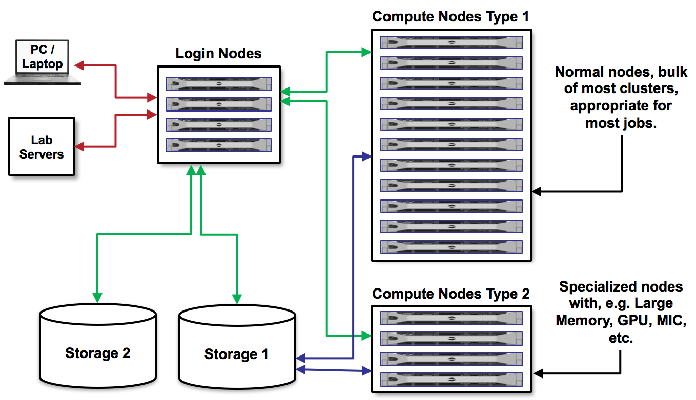

Running Batch Jobs 
==================

HPC System Architecture
-----------------------

As a reminder, it is important to understand the basic architecture of HPC systems. Think of an HPC
resource as a very large and complicated lab instrument. Users need to learn how to:

* Interface with it / push the right buttons (Linux)
* Load samples (data)
* Run experiments (jobs)
* Interpret the results (data analysis / vis)

**Login vs. Compute Nodes**

A typical HPC system has both login nodes and compute nodes. We cannot run
applications on the **login nodes** because they require too many resources and will 
interrupt the work of others. Instead, we must submit a job to a queue to run on **compute nodes**.

Log in to Lonestar6
-------------------

To log in to Lonestar6, follow the instructions for your operating system below.

Mac / Linux
~~~~~~~~~~~

Open the application 'Terminal' and:

.. code-block:: console
   
   [local]$ ssh username@ls6.tacc.utexas.edu

   To access the system:
   
   1) If not using ssh-keys, please enter your TACC password at the password prompt
   2) At the TACC Token prompt, enter your 6-digit code followed by <return>.

   (enter password)
   (enter 6-digit token)

Windows (Use WSL2 or an SSH Client)
~~~~~~~~~~~~~~~~~~~~~~~~~~~~~~~~~~~

Open the application WSL2 :

.. code-block:: console
   
   [local]$ ssh username@ls6.tacc.utexas.edu

   To access the system:
   
   1) If not using ssh-keys, please enter your TACC password at the password prompt
   2) At the TACC Token prompt, enter your 6-digit code followed by <return>.

   (enter password)
   (enter 6-digit token)

Or open an SSH client like `PuTTY <https://www.chiark.greenend.org.uk/~sgtatham/putty/latest.html>`_:

.. code-block:: console

   Open the application 'PuTTY'
   enter Host Name: ls6.tacc.utexas.edu
   (click 'Open')
   (enter username)
   (enter password)
   (enter 6-digit token)

Successful Login to Lonestar6
~~~~~~~~~~~~~~~~~~~~~~~~~~~~~

If your login was successful, your terminal will look something like this:

.. code-block:: console 

   Last login: Mon Apr 13 16:09:20 2026 from 129.114.111.41
   ------------------------------------------------------------------------------
   Welcome to the Lonestar6 Supercomputer
   Texas Advanced Computing Center, The University of Texas at Austin
   ------------------------------------------------------------------------------
   
   Unauthorized use/access is prohibited. **
   If you log on to this computer system, you acknowledge your awareness
   of and concurrence with the UT Austin Acceptable Use Policy. The
   University will prosecute violators to the full extent of the law.
   
   TACC Usage Policies:
   http://www.tacc.utexas.edu/user-services/usage-policies/
   ______________________________________________________________________
   
   Welcome to Lonestar6, please read these important system notes:
   
   06/18/2025: /work access has been restored.
   
   --> Lonestar6 user documentation is available at:
   https://portal.tacc.utexas.edu/user-guides/lonestar6
   
   ---------------------- Project balances for user wallen -----------------------
   | Name           Avail SUs     Expires | Name           Avail SUs     Expires |
   | TACC-SCI            5933  2026-07-31 | OTH22024           19171  2026-07-31 | 
   | IBN23016            8000  2027-03-31 | IBN22007            1145  2026-09-30 | 
   | DrugDiscovery       6025  2026-05-31 | DBS22003             500  2026-09-30 | 
   | STAR-Avathon        4989  2027-02-28 | OTH24028             525  2029-07-31 |
   ------------------------- Disk quotas for user wallen -------------------------
   | Disk         Usage (GB)     Limit    %Used   File Usage       Limit   %Used |
   | /scratch        33955.8       0.0     0.00      1692900           0    0.00 |
   | /home1              7.6      10.0    75.91        56672           0    0.00 |
   | /work             636.2    1024.0    62.13      2533936     3000000   84.46 |
   -------------------------------------------------------------------------------
   login1.ls6(1001)$ 

.. note::

   The welcome message you receive upon successful login to Lonestar6 has useful information
   for you to keep track of. Especially of note is the breakdown of disk quotas for your account,
   as you can keep an eye on whether your usage is nearing the determined limit. 
   
   Once your usage is nearing the quota, you'll start to experience issues that will not only
   impact your own work, but also impact the system for others. For example, if you're nearing
   your quota in ``$WORK``, and your job is repeatedly trying (and failing) to write to ``$WORK``,
   you will stress that file system.
   
   Another useful way to monitor your disk quotas (and TACC project balances) at any time is to execute:
   
   .. code-block:: console
   
      [ls6]$ /usr/local/etc/taccinfo

File Systems
------------

The account-level environment variables ``$HOME``, ``$WORK``, and ``$SCRATCH`` store the paths to
directories that you own on each of these file systems. 
 
+---------------------+-----------------------------------+--------------------------------------------------------------------------------------------------------------------+
| File System         | Quota                             | Key Features                                                                                                       | 
+=====================+===================================+====================================================================================================================+
| ``$HOME``           |- 10GB                             |- Backed up.                                                                                                        |
|                     |                                   |- Recommended Use: scripts and templates, environment settings, compilation, cron jobs                              |
+---------------------+-----------------------------------+--------------------------------------------------------------------------------------------------------------------+
| ``$WORK``           |- 1TB                              |- NOT backed up.                                                                                                    |
|                     |- 3,000,000 files                  |- Recommended Use: software installations, original datasets that can't be reproduced.                              |
+---------------------+-----------------------------------+--------------------------------------------------------------------------------------------------------------------+
| ``$SCRATCH``        |- No quota assigned                |- NOT backed up.                                                                                                    |
|                     |                                   |- Recommended Use: Reproducible datasets, I/O files: temporary files, checkpoint/restart files, job output files    |
+---------------------+-----------------------------------+--------------------------------------------------------------------------------------------------------------------+

Files in ``$SCRATCH`` are subject to purge if access time is more than 10 days old.

Navigating File Systems
~~~~~~~~~~~~~~~~~~~~~~~

To navigate the different file systems available on TACC HPC systems, you can use the standard
``cd`` command along with the ``PATH``, or you can use some TACC-specific shortcuts:

1. **Home Directory**: To change to your home directory, you can use:

   .. code-block:: console

      [ls6]$ cd $HOME
      # or
      [ls6]$ cd

2. **Work Directory**: To change to your work directory, you can use:

   .. code-block:: console

      [ls6]$ cd $WORK
      # or
      [ls6]$ cdw

2. **Scratch Directory**: To change to your scratch directory, you can use:

   .. code-block:: console

      [ls6]$ cd $SCRATCH
      # or
      [ls6]$ cds

Tips for Success
----------------

Read the `documentation <https://docs.tacc.utexas.edu/>`_.

* Learn node schematics, limitations, file systems, rules
* Learn about the scheduler, queues, policies
* Determine the right resource for the job

User Responsibility on Shared Resources
~~~~~~~~~~~~~~~~~~~~~~~~~~~~~~~~~~~~~~~

HPC systems are shared resources. Your jobs and activity on a cluster, if mismanaged,
can affect others. TACC staff are always `available to help <https://www.tacc.utexas.edu/about/help/>`_.

Additional Resources
--------------------

* `TACC Docs <https://docs.tacc.utexas.edu/>`_
* `Lonestar6 Docs <https://docs.tacc.utexas.edu/hpc/lonestar6/>`_

